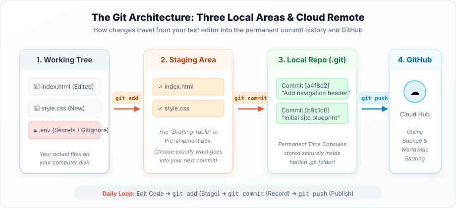

# Chapter 2: How Git Works Under the Hood ⚙️

---

## 🌟 Real-Life Story

**Packing a Parcel**

Bilal is sending a parcel of books to his cousin in Jammu. His desk is covered with books, letters and wrapping paper. He does not tip the whole messy desk into the parcel. He picks only the two books and the letter, and puts them in the box. Then he seals the box and writes a tracking number on it. Git moves your work through the same steps: desk, box, sealed parcel.

---

## 🎯 What You Will Learn

- Name Git's three local areas: the **working tree**, the **staging area** and the **repository**.
- Explain why `git add` comes before `git commit`.
- Describe what the hidden `.git` folder holds.
- Trace the journey of a file from your editor to a commit (and later to GitHub).

---

## 📦 The Parcel and the Three Areas

Each part of the parcel story matches a part of Git:

| Parcel story | Git name | What it is |
|---|---|---|
| Messy desk | **Working tree** | The files you can see and edit in your folder |
| Open box | **Staging area** | The changes you have picked for the next commit |
| Sealed parcel | **Repository** | The saved commits inside the `.git` folder |
| Courier van | **Remote** (e.g. GitHub) | A copy of the repository on another computer |

The staging area is also called the **index**. The first three areas are all on your own computer. That is why they are called **local**.

---

## 👁️ The Journey of a Change



```text
┌──────────────────────────┐
│ 1. WORKING TREE          │
│    files you edit        │
└────────────┬─────────────┘
             │ git add
             ▼
┌──────────────────────────┐
│ 2. STAGING AREA          │
│    picked for next save  │
└────────────┬─────────────┘
             │ git commit
             ▼
┌──────────────────────────┐
│ 3. LOCAL REPOSITORY      │
│    commits in .git       │
└────────────┬─────────────┘
             │ git push (Ch 14)
             ▼
┌──────────────────────────┐
│ 4. REMOTE (GitHub)       │
│    shared online copy    │
└──────────────────────────┘
```

---

## 💻 Example: Watching a File Move

Ayesha has a school website that already has one commit. She adds a welcome banner to `index.html` and also makes a new file, `logo.png`. She asks Git what it sees:

```bash
git status
```

```text
On branch main
Changes not staged for commit:
  (use "git add <file>..." to update what will be committed)
  (use "git restore <file>..." to discard changes in working directory)
	modified:   index.html

Untracked files:
  (use "git add <file>..." to include in what will be committed)
	logo.png

no changes added to commit (use "git add" and/or "git commit -a")
```

Both changes are only in the **working tree**. Now she puts `index.html` in the box (the staging area):

```bash
git add index.html
git status
```

```text
On branch main
Changes to be committed:
  (use "git restore --staged <file>..." to unstage)
	modified:   index.html

Untracked files:
  (use "git add <file>..." to include in what will be committed)
	logo.png
```

`index.html` is now under **Changes to be committed** (green in most terminals). `logo.png` is still **untracked** (red), which means Git is not looking after it yet. Finally, she seals the box:

```bash
git commit -m "Add welcome banner to home page"
```

```text
[main e1b4138] Add welcome banner to home page
 1 file changed, 1 insertion(+)
```

Only `index.html` went into the commit. Later, `git push` sends commits to GitHub. You will learn that in Chapter 14. You will learn each command step by step in Chapters 4 to 6.

---

## 🔍 Why Have a Staging Area?

Many beginners ask: *"Why must I run `git add` before `git commit`?"*

Imagine you did two jobs this afternoon:

1. You built a new menu in `navbar.html`.
2. You fixed a spelling mistake in `about.html`.

The staging area lets you save them as **two separate commits**:

- Stage only `navbar.html`, then commit `Add navigation menu`.
- Stage `about.html`, then commit `Fix spelling in principal's welcome note`.

Each commit does one job. Your history stays clean and easy for others to read. You also never save something by accident, such as a file with a password in it.

---

## 🌍 Real-World Connection

**The hidden `.git` folder**

When you turn a folder into a Git repository, Git makes a hidden folder called `.git` inside it.

- Everything Git knows is inside `.git`: every commit, every branch and the staging area.
- If you copy your project **without** `.git`, you copy the files but lose all the history.
- If `.git` is safe, you can bring back any committed file, even after deleting it from the folder.

---

## 🔮 Predict the Output

A developer changes two files: `contact.html` and `secrets.env`. They run:

```bash
git add contact.html
git commit -m "Update office phone number"
```

**Question**: Is `secrets.env` in the new commit?

<details>
<summary>👀 Click to check your answer</summary>

**Answer:** No. Only files in the staging area go into a commit. `secrets.env` was never added, so it stays in the working tree and is not saved by Git.

</details>

---

## 🕵️ Code Detective

**The Red and Green Files**

A student types `git status` and sees:

```text
Changes to be committed:
  (use "git restore --staged <file>..." to unstage)
	modified:   index.html

Untracked files:
  (use "git add <file>..." to include in what will be committed)
	logo.png
```

- **Green `index.html`**: it is in the **staging area**, ready for the next commit.
- **Red `logo.png`**: it is only in the **working tree**. Git has not been told to track it yet.

---

## ⚠️ Common Mistake

**Mistake 1: Committing without adding first**

**Wrong:**

```bash
git commit -m "Add banner"
```

**What happens:** nothing is saved. Git shows:

```text
no changes added to commit (use "git add" and/or "git commit -a")
```

(If the only new files are untracked, the last line says `nothing added to commit but untracked files present (use "git add" to track)`.)

**Fixed:**

```bash
git add index.html
git commit -m "Add banner"
```

**Mistake 2: Deleting the `.git` folder**

- **Wrong idea**: "`.git` looks like junk. I will delete it to tidy up."
- **What happens**: your folder stops being a Git repository. All commits and history are gone.
- **Fixed idea**: leave `.git` alone. It is Git's memory.

---

## ✍️ Try It

Draw the parcel journey on paper (or in a notes app) for a real task. Choose a file such as `timetable.html`.

1. Draw four boxes: working tree, staging area, repository, remote.
2. Write the command on each arrow between them.
3. Write where `timetable.html` is after each command.

<details>
<summary>Hint</summary>

The arrows are `git add`, then `git commit`, then `git push`. After `git add`, the file's change is in the staging area. After `git commit`, it is saved in `.git`.

</details>

---

## 📝 Recap

- Git has three local areas: the working tree, the staging area and the repository.
- `git add` puts chosen changes in the staging area (the box).
- `git commit` seals the staged changes into a permanent snapshot.
- Everything Git knows lives in the hidden `.git` folder.
- A remote such as GitHub is a shared copy you send commits to with `git push`.

---

## 🏆 Practice

### 🟢 Level 1: Recall

1. Name Git's three local areas in order.
2. Which command moves a changed file from the working tree to the staging area?
3. Which hidden folder holds Git's history?

<details>
<summary>Show answer</summary>

1. Working tree → staging area → local repository.
2. `git add`, for example `git add index.html`.
3. The `.git` folder.

</details>

### 🟡 Level 2: Apply

1. Explain the difference between `git add` and `git commit` with your own everyday example.
2. Why is a staging area safer than saving every change straight into the history?
3. You edited `app.js` and `notes.txt`, but only `app.js` is ready. Which commands save only `app.js`?

<details>
<summary>Show answer</summary>

1. Example: packing a school bag. `git add` is putting chosen books into the bag. `git commit` is zipping the bag and writing the date on a label.
2. You choose exactly what goes in. Half-finished work or private files are not saved by accident.
3. Stage only `app.js`, then commit:

```bash
git add app.js
git commit -m "Add search to library page"
```

</details>

### 🔴 Level 3: Challenge

1. You edit `index.html`, run `git add index.html`, then edit `index.html` **again** before committing. Predict what `git status` shows.
2. Which version of the file would `git commit` save: the first edit, or both edits?
3. Write a short rule (3–4 lines) for your coding club explaining why passwords and private student data must never be added to any Git commit (*Amānah*).

<details>
<summary>Show one possible answer</summary>

1. The file appears **twice**: once under "Changes to be committed" and once under "Changes not staged for commit":

   ```text
   Changes to be committed:
     (use "git restore --staged <file>..." to unstage)
   	modified:   index.html

   Changes not staged for commit:
     (use "git add <file>..." to update what will be committed)
     (use "git restore <file>..." to discard changes in working directory)
   	modified:   index.html
   ```

2. Only the first edit, because that is what was staged. Run `git add index.html` again to include the second edit.
3. Example rule: "Passwords and student details are a trust (*Amānah*). Once they are in a commit, anyone with a copy of the repository can read them. Keep them in files that Git ignores. If a secret is ever committed, tell your teacher and change it."

</details>
